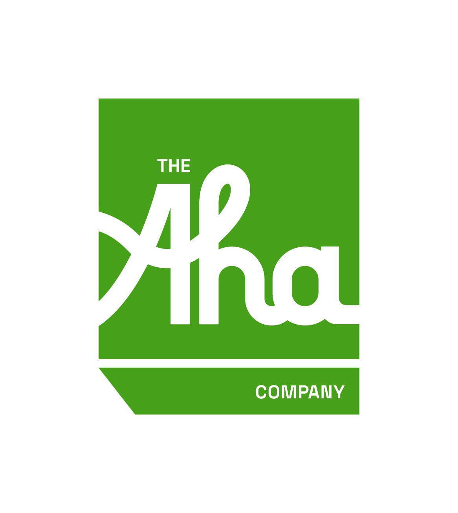
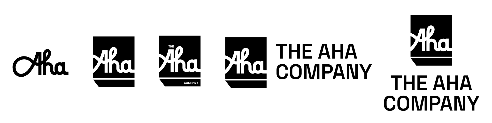
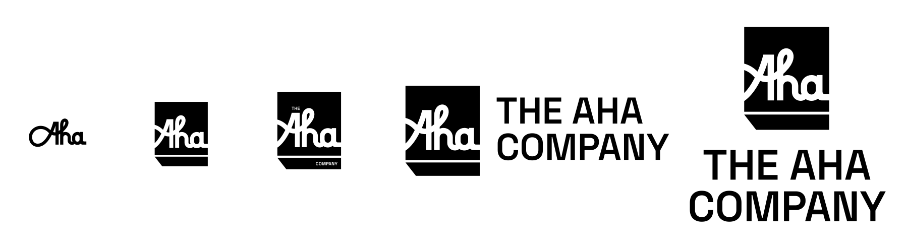
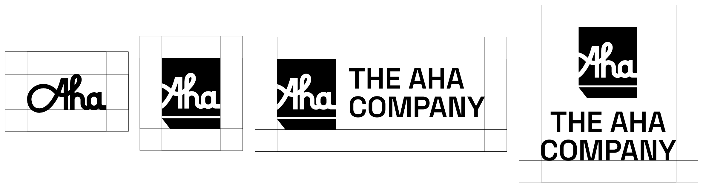
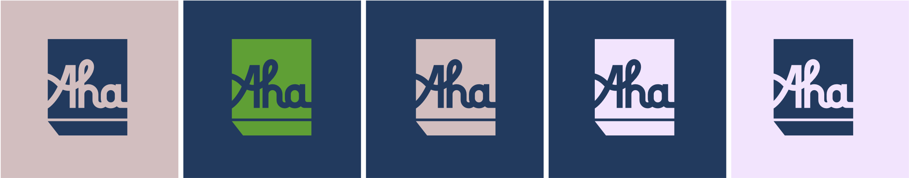
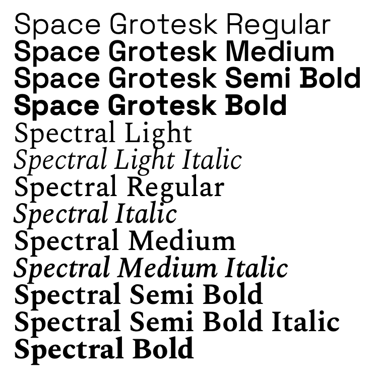
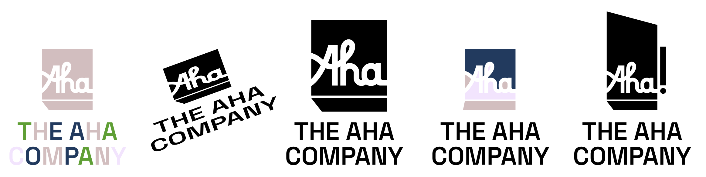

  <h1></h1>
  <h2>Brand Identity Standards</h2>

# Logo Mark

The logo is a foundational element of the brand identity, serving as the key element for visual brand recognition. The Aha logo mark is a formed in a custom script type lock in a stylized exclamation point holding shape.

# Logo Variations

The Aha logos function as a system within the brand identity to increase versatility through application. Illustrated above are the approved layouts (or “lockups”) in which the logo may be shown. The lockup selected for use must showcase prominent representation of the brand, as well as overall cohesiveness with surrounding elements.

# Scaling and Sizing

When sizing the Aha logo, surrounding environment and application should be taken into consideration to maintain a high standard for representation and recognizability. As illustrated above, legibility must be maintained when scaling down in size.

# Area of Isolation

The area surrounding the logo has an impact on display, effectiveness and portraying the reputation of the brand. To keep a cohesive and consistent representation, the area equating to 70% of the height of the first “A” on every side of the logo, should remain clear with the exception of background elements (colors, images, textures or patterns).

# Color Palette

| DEEP BLUE | VIBRANT GREEN | LIGHT TAN | COOL PINK |
| --------- | ------------- | --------- | --------- |
| <svg viewBox="0 0 50 10"><rect width="50" height="10" fill="#1A3B60" /></svg> | <svg viewBox="0 0 50 10"><rect width="50" height="10" fill="#47A019" /></svg> | <svg viewBox="0 0 50 10"><rect width="50" height="10" fill="#D6BDBE" /></svg> | <svg viewBox="0 0 50 10"><rect width="50" height="10" fill="#F6E2FF" /></svg> |
| HEX: #1A3B60 | HEX: #47A019 | HEX: #D6BDBE | HEX: #F6E2FF |
| RGB: 26, 59, 96 | RGB: 71, 160, 25 | RGB: 214, 189, 190 | RGB: 246, 226, 255 |
| CMYK: 97, 80, 37, 27 | CMYK: 75, 13, 100, 2 | CMYK: 15, 25, 18, 0 | CMYK: 3, 12, 0, 0 |

The Aha logo is designed to be displayed as a one-color design. The color application of the logo should be dictated by application of the logo, paying close attention to design elements, colors and treatments.

# Color Variation

Illustrated above are the approved color combinations in which the logo may be shown.

# Typography

- Space Grotesk (Regular, Medium, Semi Bold, Bold)
- Spectral (Light, Light  Italic, Regular, Italic, Medium, Medium Italic, Semi Bold, Semi Bold Italic, Bold)

To complement the design and nature of The Aha Company Brand, specific primary brand fonts are used to create the typographic system. These families are the official typefaces of Aha and is preferred for use for all marketing and communication materials.

# Incorrect Logo Usage

The Aha logo must maintain accurate presentation within any application. Incorrect use of the logo reflects poorly on the brand and must be corrected in a timely manner. Illustrated below are ways in which the logo should never appear as official representation. Incorrect uses are not limited to these examples. Any use of the logo in question will be addressed for clarification.
